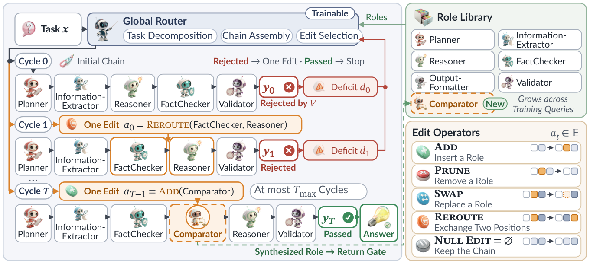

<div align="center">

<h1>RoleFlow</h1>

<h3>🧩 Self-Evolving Multi-Role Agentic Collaboration via Structural Adaptation</h3>

<p><i>🕶️ Anonymous code release for double-blind review</i></p>

<p>
<b>🧭 Global Router</b> &nbsp;•&nbsp;
<b>✂️ Edit Operators</b> &nbsp;•&nbsp;
<b>📚 Role Library</b>
</p>

<p>
✨ Highlights &nbsp;|&nbsp;
🧭 Overview &nbsp;|&nbsp;
🔧 Setup &nbsp;|&nbsp;
🚀 Quick start &nbsp;|&nbsp;
🎓 Train &nbsp;|&nbsp;
🔁 Infer &nbsp;|&nbsp;
📊 Evaluate
</p>

</div>

<br>

**RoleFlow** is a self-evolving multi-role agentic system that refines collaboration structures through feedback-driven atomic edits and on-demand role synthesis. A trainable **Global Router (GR)** builds a task-specific RoleFlow chain of roles, applies one structural edit after every rejected cycle, and synthesizes the specialists the chain needs. **Single-Edit Counterfactual Policy Optimization (SECPO)** makes these decisions learnable: it evaluates each edit against its no-edit counterpart at the same chain state and assigns targeted credit to the tokens that spell the edit.

## ✨ Highlights

- 🧩 **Atomic structural edits.** Add, Prune, Swap, Reroute and the null edit, at most one per adaptation cycle, with on-demand role synthesis for every role the GR names outside the library.
- 🧭 **A trainable Global Router** writes the plan of a task: the roles of the initial chain and one edit for every rejected cycle.
- ⚖️ **SECPO** executes the same chain state with and without the candidate edit, commits the edit only when its single-edit advantage exceeds the threshold δ, and adds the advantage with weight λ on the edit-token span on top of the group-relative advantage.
- 📚 **A return-gated role library** admits a synthesized role only when its rollout return exceeds that of the reference rollout.
- 📈 **Results.** Across seven benchmarks spanning four domains, RoleFlow achieves the optimal average performance, surpassing the strongest competitor by 4.7 points, and leads on all three multi-hop QA benchmarks by 3.2–7.5 F1 points. Further analyses demonstrate cross-benchmark transferability, training-data efficiency and cross-executor generalization.

<br>

<div align="center">



</div>

## 🧭 Overview

The pipeline:

| | Step | Introduction | Entry point |
|:-:|:--|:--|:--|
| 🎓 | **1&nbsp;·&nbsp;Train** | *SECPO: Edit-Level Counterfactual Credit Assignment*, *On-Demand Role Synthesis and Library Growth*, Algorithm *Global Router Learning with SECPO* | `scripts/train.sh` |
| 🔁 | **2&nbsp;·&nbsp;Infer** | *RoleFlow: Feedback-Driven Structural Adaptation*, Algorithm *RoleFlow Test-Time Inference* | `scripts/infer.sh` |
| 📊 | **3&nbsp;·&nbsp;Evaluate** | *Experimental Setup* | `scripts/evaluate.sh` |

For example, the commands below train the GR on HotpotQA and run inference and evaluation with that GR on MuSiQue; the other benchmarks run the same inference and evaluation steps with their files in `configs/`, and the MATH and MBPP configs train their own GR.

🎛️ What a run selects:

| Choice | Config key | Configuration |
|:--|:--|:--|
| Domain and benchmark | `domain`, `benchmark` | `configs/multihop_qa.yaml`, `configs/mathematical_reasoning.yaml`, `configs/code_generation.yaml`, `configs/web_interaction.yaml` |
| Executor LLM | `executor.*` | Any OpenAI-compatible endpoint (e.g. gpt-4o-mini) |
| Global Router | `global_router.*` | The GR served by `scripts/serve.sh` (e.g. the GR trained from Qwen2.5-7B-Instruct) |
| Seed library | `library.seed` | `roles/<domain>.json` |
| Adaptation cycles | `maximum_cycles` | T_max |
| Chains per task | `sampling.chains` | One chain per question on QA, twenty per problem on MATH-500, ten on MBPP and HumanEval, one per round on WebShop |
| SECPO settings | `secpo.*` | `assets/settings.md` |

A domain plugs in through its task validator, its seed roles, its GR plan prompt, its loader and its entry in the benchmark catalog: `roleflow/<domain>.py`, `roles/<domain>.json`, `prompts/global_router/<domain>.txt` and `roleflow/benchmarks.py`.

## 🔧 Setup

Python 3.11 or 3.12.

```bash
pip install -r requirements.txt
pip install flash-attn==2.8.3 --no-build-isolation
```

WebShop also needs the WebShop environment of AgentBench, JDK 21 with `JAVA_HOME` set, and `python -m spacy download en_core_web_lg`.

Serve the GR:

```bash
MODEL=Qwen/Qwen2.5-7B-Instruct GPUS=1 bash scripts/serve.sh
```

`MODEL` is the directory that training exports or the backbone; the server answers at `localhost:8000/v1` under the name `global_router`, and `GPU_MEMORY` sets the share of GPU memory it takes. Set `executor.api_base` and `executor.api_key` in the config; `configs/mathematical_reasoning.yaml` also takes `judge.*` for the equivalence judge, and `configs/web_interaction.yaml` takes `web_interaction.environment`, the directory of the WebShop environment.

Prepare the benchmarks of the walkthrough:

```bash
bash scripts/prepare.sh --benchmark hotpotqa
bash scripts/prepare.sh --benchmark musique
```

Run the tests:

```bash
python -m pytest tests -q
```

## 🚀 Quick start

With the GR served and the executor set in `configs/sample.yaml`:

```bash
bash scripts/infer.sh --config configs/sample.yaml
bash scripts/evaluate.sh --config configs/sample.yaml
```

The predictions and the scores are written under `outputs/sample/`.

## 🎓 1 · Train

```bash
bash scripts/train.sh --config configs/multihop_qa.yaml
```

For every training task the GR samples K plans, and each rollout runs the adaptation loop with its own role overlay. At every rejected cycle the same chain state is executed with and without the candidate edit; the single-edit advantage decides whether the edit is committed and is added with weight λ on the tokens that spell the edit. After the update, the return gate admits the synthesized roles of the rollouts that beat their reference rollout. The last checkpoint is exported to `outputs/<benchmark>/train/global_router/`, ready for `scripts/serve.sh`.

One SECPO step:

| Stage | Description | Code |
|:--|:--|:--|
| Rollouts | K plans per task, each with its role overlay | `train.SECPORewardManager`, `library.RoleOverlay` |
| Counterfactual pair | The same chain state is executed with and without the candidate edit | `secpo.counterfactual_pair` |
| Single-edit advantage | A = R(y⁺) − R(y⁰), with the cycle reward R(y) = h + λ_s s | `secpo.single_edit_advantage`, `secpo.cycle_reward` |
| Commit | The edit is kept when A > δ, otherwise the chain stays unchanged | `secpo.commit` |
| Token-level advantage | Ã = A^GRPO + λ · 1[token in the edit span] · A | `secpo.token_level_advantage` |
| Update | The SECPO loss: PPO's clipped objective with KL regularization | `train.verl_config`, `train.make_trainer_class` (SECPOTrainer) |
| Return gate | A synthesized role enters the library when its rollout return exceeds that of the reference rollout | `library.return_gate` |

## 🔁 2 · Infer

```bash
bash scripts/infer.sh --config configs/multihop_qa.yaml --benchmark musique
```

Every task starts from the seed library of its domain. The GR writes the plan, the chain is executed once per cycle, and the loop ends at the first accepted output or after T_max adaptation cycles; a role the GR names but the library lacks is synthesized on demand.

One adaptation cycle:

| Stage | Description | Code |
|:--|:--|:--|
| Execution | (y_t, z_t, c_t) = RFC_t(σ_t, x): the executor LLM implements each role with one call | `chain.RoleFlowChain.execute` |
| Validation | (h_t, s_t, d_t) = V(y_t, z_t) | `task_validator.TaskValidator.assess` |
| Edit | a_t: Add(ρ) (insert ρ before the final role, the OutputFormatter that closes every chain), Prune(ρ) (remove ρ), Swap(ρ, ρ′) (replace ρ by ρ′ in place), Reroute(p, q) (exchange the roles at positions p and q), or the null edit | `global_router.candidate_edit` |
| Next chain | RFC_{t+1} = RFC_t ⊕ a_t | `chain.RoleFlowChain.apply` |

The sampling and selection of each domain is listed in `assets/benchmarks.md`. The programs of MBPP and HumanEval run in a temporary directory with time and memory limits; the sandbox is a directory, not a container.

## 📊 3 · Evaluate

```bash
bash scripts/evaluate.sh --config configs/multihop_qa.yaml --benchmark musique
```

| Benchmark | Metric | How it is scored |
|:--|:--|:--|
| HotpotQA, 2WikiMultiHopQA, MuSiQue | F1 | The token-level F1 between the normalized predicted and reference answers |
| MATH-500 | Accuracy | The `\boxed{}` answer is compared with the reference after normalization; when the strings differ, gpt-4o-mini at temperature 0 judges whether the two answers are equivalent |
| MBPP, HumanEval | Pass@1 | A problem counts as solved when the single submitted program passes every test case of the benchmark |
| WebShop | WebShop score | The purchase reward averaged over the 500 tasks, times 100 |

## 📝 Citation

```bibtex
@misc{roleflow,
  title  = {RoleFlow: Self-Evolving Multi-Role Agentic Collaboration via Structural Adaptation},
  author = {Anonymous},
  year   = {2026},
  note   = {Under double-blind review}
}
```
